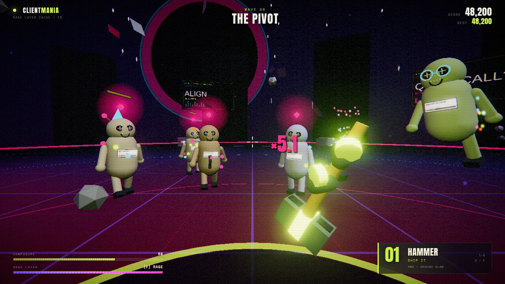
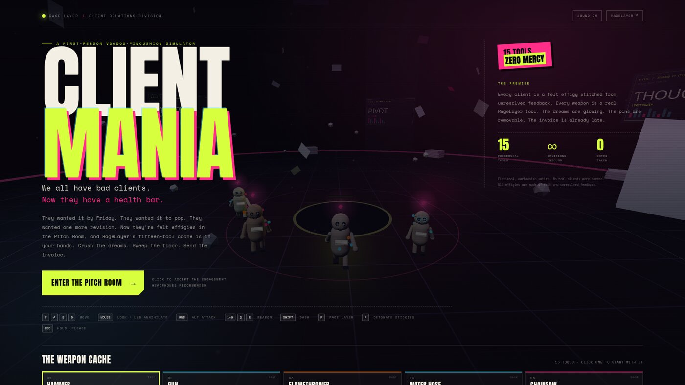
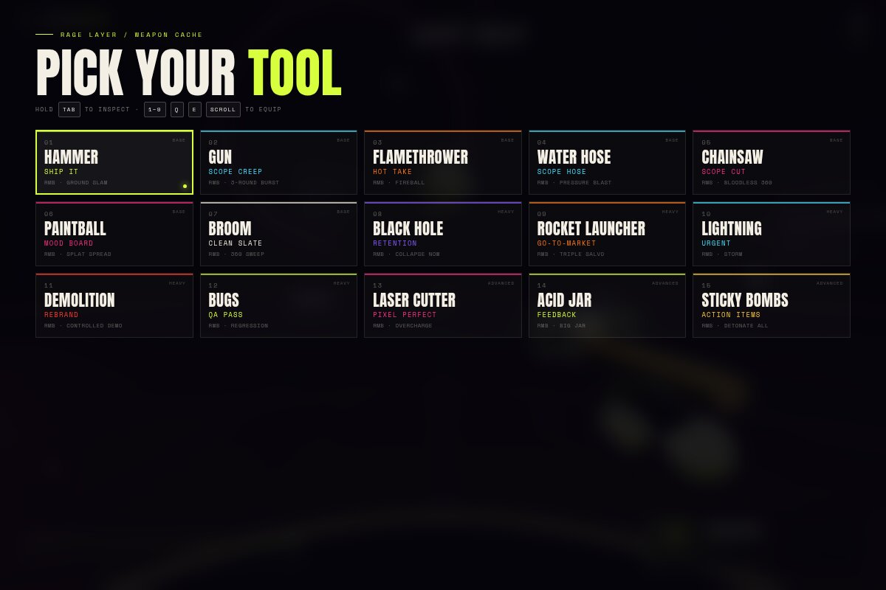
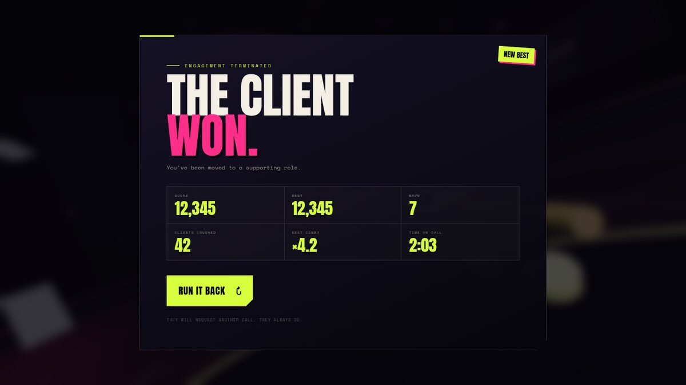

# CLIENTMANIA

**A first-person voodoo-pincushion hack-and-slash. Fifteen tools. Zero notes.**

[▶ PLAY THE GAME](https://randyellis-wealthberry.github.io/clientmania/) · [RageLayer](https://www.parthjadhav.com/products/ragelayer) · [Weapon cache](#the-weapon-cache) · [Run it locally](#run-it-locally)



> We all have bad clients. In CLIENTMANIA they're felt effigies stitched from unresolved feedback, shambling across the Pitch Room with their dreams glowing above their heads. You have RageLayer's fifteen-tool cache. You have a mouse. You have a deadline.

**CLIENTMANIA** is a browser-based 3D first-person arena game about the specific workplace feeling of receiving one more revision at 17:58 on a Friday. The clients are cartoon voodoo dolls. The weapon cache is an unofficial 3D interpretation of the fifteen procedural tools in [RageLayer](https://www.parthjadhav.com/products/ragelayer). The floor is a grid. The invoice is already late.

Fictional, cartoonish satire. No real clients were harmed. All effigies are made of felt, pins, and unresolved feedback. No gore.

---

## The pitch

- **Wave-based first-person arena combat** against an endless supply of stakeholders, procurement committees, and people who "just have a quick note".
- **Fifteen weapons**, each with a primary attack and a secondary attack, from the Ship It hammer to the retention black hole.
- **Destructible-feeling feedback:** ragged detachable limbs, flying pins, confetti, ink splats, damage numbers, hitstop, screen shake, and a very rude kill feed.
- **Rage Layer meter.** Deal damage, fill it, press `F`, become the problem.
- **Bosses every five waves.** The Stakeholder has joined the call. They brought a bigger health bar.
- **A full procedural presentation:** no model files, no image assets, no audio files, no runtime network requests. The arena, dolls, weapons, textures, music, and screams are generated in code.
- **Desktop-first:** mouse and keyboard required. There is a mobile warning, not a mobile control scheme.

## Screens

| The Pitch Room | Pick your tool |
| --- | --- |
|  |  |
| **Feedback loop** | **Contract terminated** |
|  |  |

## The weapon cache

All fifteen tools from RageLayer's cache, reimagined as first-person weapons. Ammo is infinite; catharsis is the resource.

| Slot | Tool | In-game name | Primary | Secondary (`RMB`) |
| --- | --- | --- | --- | --- |
| 01 | Hammer | **Ship It** | Heavy melee arc, big knockback | Ground slam |
| 02 | Gun | **Scope Creep** | Hitscan sidearm | Three-round burst |
| 03 | Flamethrower | **Hot Take** | Cone of fire + burn | Fireball |
| 04 | Water Hose | **Scope Hose** | Pressure jet, shoves clients | Pressure blast |
| 05 | Chainsaw | **Scope Cut** | Continuous shredding | Bloodless 360 |
| 06 | Paintball | **Mood Board** | Fast splat projectiles | Seven-pellet spread |
| 07 | Broom | **Clean Slate** | Wide sweep, huge knockback | 360 sweep |
| 08 | Black Hole | **Retention** | Gravity well that pulls and damages | Collapse it now |
| 09 | Rocket Launcher | **Go-To-Market** | Splash damage | Triple salvo |
| 10 | Lightning | **Urgent** | Sky strike + chain | Storm |
| 11 | Demolition | **Rebrand** | Sticky charge | Controlled demolition |
| 12 | Bugs | **QA Pass** | Jar of hungry QA | Regression swarm |
| 13 | Laser Cutter | **Pixel Perfect** | Piercing beam | Overcharge |
| 14 | Acid Jar | **Feedback** | Corrosive splash | Big jar |
| 15 | Sticky Bombs | **Action Items** | Throw and stick | Detonate all (`R` also works) |

## Controls

| Input | Action |
| --- | --- |
| `W` `A` `S` `D` | Move |
| Mouse | Look |
| `LMB` | Primary attack |
| `RMB` | Secondary attack |
| `1`–`9` | Quick-select the first nine tools |
| `Q` / `E` / mouse wheel | Cycle the full cache |
| `Tab` (hold) | Weapon cache overlay |
| `Shift` | Dash |
| `Space` | Jump |
| `F` | Activate Rage Layer when the meter is full |
| `R` | Detonate all sticky bombs |
| `M` | Mute / unmute |
| `L` | Toggle full quality / potato mode |
| `Esc` / `P` | Pause (the client has stepped away from the call) |

## How it works

- **Three.js** rendering, with an `EffectComposer` stack: ACES tone mapping, Unreal bloom, and a custom grade pass for chromatic aberration, grain, scanlines, vignette, and rage/damage tinting.
- **TypeScript + Vite**, no runtime dependencies beyond Three.js.
- **All geometry is procedural.** The clients are capsules, buttons, stitches, instanced pins, and accessories. Every weapon is built from primitives. The arena is an instanced-window corporate monolith ring around a grid floor.
- **All textures are Canvas 2D.** Billboards, name tags, scream bubbles, splats, and the OG image all start as canvas drawings.
- **All audio is WebAudio synthesis.** The screams are formant-filtered sawtooths. The soundtrack is a scheduled 132 BPM loop of kicks, noise hats, and a minor-key bassline.
- **Ragdoll-adjacent deaths.** Parts detach, spin, bounce, and shrink away; pins burst; the dream shatters into magenta particles.
- **Continuous projectile collision.** Fast paintballs and rockets use segment tests so they don't tunnel through a client between frames.
- **Adaptive quality.** The game detects software renderers and low-core machines, drops bloom/shadows, and offers a manual `L` toggle. Full quality is the default on real GPUs.

## Run it locally

Requires Node.js 20+.

```bash
npm install
npm run dev       # http://localhost:5173
npm run build     # typecheck + production build into dist/
npm run preview   # serve the production build
```

Optional URL parameters:

- `?quality=low` — force potato mode
- `?quality=full` — force full bloom even on a software renderer
- `?debug=1` — expose `window.clientmania` for poking at the simulation

## Deploy

Pushing to `main` runs [.github/workflows/deploy.yml](.github/workflows/deploy.yml), builds the game, and publishes `dist/` to GitHub Pages. The Vite build uses a relative base, so it also works on itch.io, Netlify, or any static host.

## Credits

- **RageLayer** by [Parth Jadhav](https://www.parthjadhav.com/products/ragelayer) — the fifteen-tool cache that inspired the arsenal. This is an unofficial fan project and is not affiliated with RageLayer or Parth Jadhav. No RageLayer code is bundled.
- **Anton** and **Space Mono** — SIL Open Font License 1.1. License texts live in [`src/assets/fonts/`](src/assets/fonts/).
- Built with [Three.js](https://threejs.org/), [Vite](https://vite.dev/), and TypeScript.

## License

[MIT](LICENSE) © 2026 Randy Ellis

---

**Content note:** CLIENTMANIA is dark workplace comedy. The "clients" are clearly fictional felt dolls with pins in them. There is no gore, no realistic violence, and no real person or company is depicted. If you are currently on a call, please hold — someone will be with you shortly.
